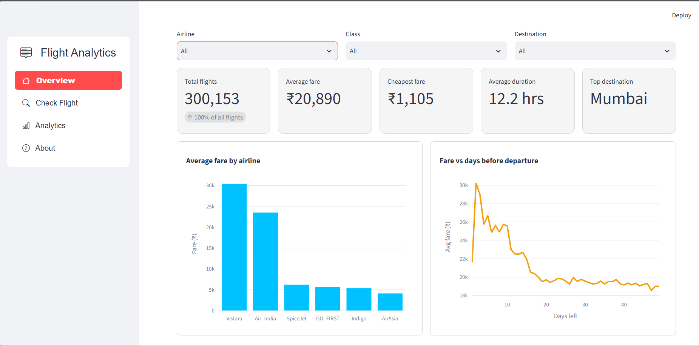
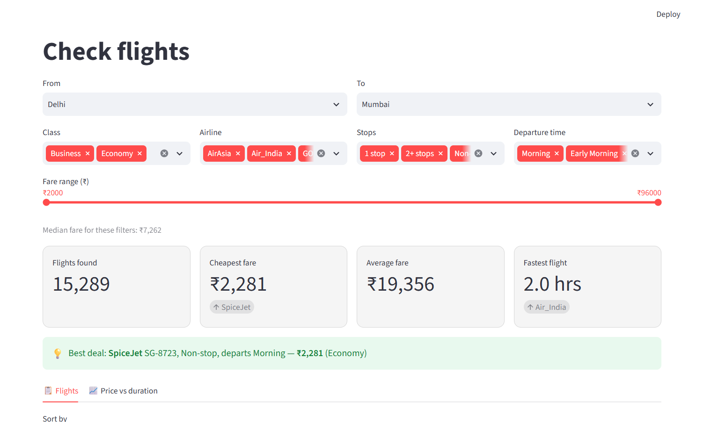
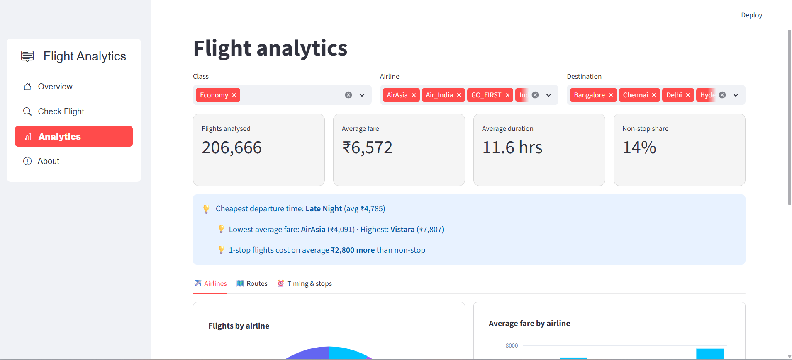
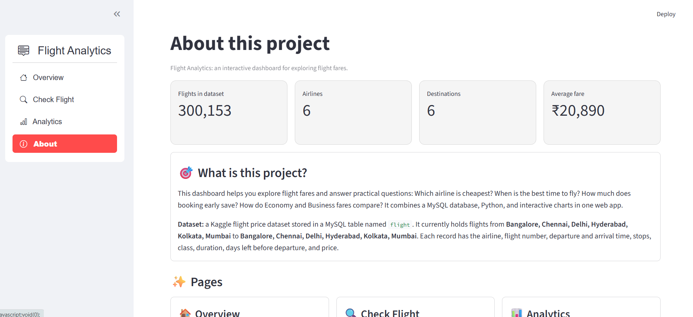

# ✈️ Flight Analytics Dashboard

An interactive dashboard for exploring flight fares, built with **Python, Streamlit, MySQL and Plotly**.
It helps answer practical questions: Which airline is cheapest? When is the best time to fly? How much does
booking early save? How do Economy and Business fares compare?

## Screenshots

| Overview | Check Flight |
|---|---|
|  |  |

| Analytics | About |
|---|---|
|  |  |

## Features

### 🏠 Overview
- Filter by **airline, class and destination**
- 5 KPI cards (total flights, average fare, cheapest fare, average duration, top destination) with comparison arrows
- Average fare by airline
- How fares change as the departure date gets closer

### 🔍 Check Flight
- Pick a route; the destination list only shows cities that have flights from the chosen origin
- Live filters: class, airline, stops, departure time and an adaptive fare range slider
- "Best deal" highlight and summary cards (flights found, cheapest, average, fastest)
- Sortable results table with **CSV download**
- Price vs duration scatter plot

### 📊 Analytics
- Share of flights by airline and by destination
- Average fare by airline, destination, departure time and number of stops
- Destination × departure time heatmap
- Auto-generated insights (cheapest time to fly, cheapest airline, non-stop vs 1-stop difference)

### ℹ️ About
- Project summary, live dataset statistics, tech stack and a data-flow diagram

The dashboard works in both **light and dark** mode.

## Tech stack

| Layer | Tools |
|---|---|
| Language | Python 3.10+ |
| Web app | Streamlit, streamlit-option-menu |
| Database | MySQL, mysql-connector-python |
| Data handling | pandas |
| Charts | Plotly |

## How it works

```
MySQL  →  dbhelper.py (SQL queries)  →  Streamlit cache  →  pandas filters  →  Plotly charts
```

- `dbhelper.py` runs parameterized SQL queries and opens a fresh connection for each query, so a dropped
  connection never breaks the app.
- Query results are cached with `st.cache_data`, so the app stays fast.
- Filters run in pandas on already-loaded data, so charts update instantly.

## Dataset

A Kaggle flight price dataset (Flight Price Prediction) loaded into a MySQL table named `flight` with these columns:

`airline, flight, source_city, departure_time, stops, arrival_time, destination_city, class, duration, days_left, price`

> The dataset contains fares only. It has **no delay or cancellation data**, and `days_left` is the number of days
> between booking and departure.

## Project structure

```
flight-dashboard/
├── app.py                   # Streamlit app (all pages)
├── dbhelper.py              # Database queries
├── requirements.txt         # Python dependencies
├── screenshots/             # Images used in this README
├── .streamlit/
│   └── secrets.toml         # DB credentials (NOT uploaded to Git)
└── .gitignore
```

## Getting started

### 1. Clone the project

```bash
git clone https://github.com/<your-username>/flight-dashboard.git
cd flight-dashboard
```

### 2. Create an environment and install dependencies

```bash
conda create -p ./myenv python=3.12 -y
conda activate ./myenv
pip install -r requirements.txt
```

(You can also use `python -m venv myenv` instead of conda.)

### 3. Set up the database

1. Download the dataset from Kaggle (search for **Flight Price Prediction**).
2. In MySQL, create a database (for example `mydb`) and import the CSV into a table named `flight`
   (MySQL Workbench's **Table Data Import Wizard** can create the table from the CSV).
   If the CSV has an unnamed index column, skip it.
3. Make sure the table has the columns listed in the **Dataset** section.

### 4. Add your database credentials

Create the file `.streamlit/secrets.toml`:

```toml
[db]
host = "127.0.0.1"
user = "your_mysql_user"
password = "your_mysql_password"
database = "mydb"
```

This file is listed in `.gitignore`, so it is never uploaded. **Never commit it.**

### 5. Run the app

```bash
streamlit run app.py
```

Then open http://localhost:8501 in your browser.

## Security notes

- Credentials are read from `.streamlit/secrets.toml` and are not stored in the code.
- For extra safety, give the dashboard a **read-only MySQL user**. It only runs `SELECT` queries:

  ```sql
  CREATE USER 'dashboard'@'localhost' IDENTIFIED BY 'a_strong_password';
  GRANT SELECT ON mydb.flight TO 'dashboard'@'localhost';
  ```
- All queries use parameter placeholders (`%s`), which protects against SQL injection.

## Troubleshooting

| Problem | Fix |
|---|---|
| `StreamlitSecretNotFoundError` or `KeyError` | Check that `.streamlit/secrets.toml` exists and contains a `[db]` section with all four keys |
| `Unknown column ...` | The `flight` table is missing a column listed in the Dataset section |
| `Fatal error in launcher` after renaming or moving the folder | Virtual environments store absolute paths. Delete `myenv` and recreate it (step 2) |
| Warning about `use_container_width` | Harmless deprecation warning in recent Streamlit versions |

## Future improvements

- A Compare page (two airlines or routes side by side)
- A machine-learning fare predictor
- Deploy online with Streamlit Community Cloud

## License

Add a license of your choice (for example MIT) if you plan to share this project publicly.
